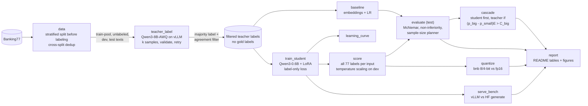

# Replace an expensive LLM with a small model you own

[](https://colab.research.google.com/github/isarinio22/llms/blob/main/notebooks/colab_end_to_end.ipynb)


An end-to-end, reproducible case study of **distilling a large LLM into a small model a company owns**, and of
proving, with paired statistics rather than vibes, when it is safe to switch. Everything runs on a **free Colab T4**;
every stage also runs on a laptop CPU in a few-minute smoke mode.

**The task.** A digital bank routes every incoming support ticket to one of 77 intents
([Banking77](https://huggingface.co/datasets/PolyAI/banking77), human-labeled). Today a large LLM does the routing.
It works, but every ticket is a paid call to a model the bank does not control.

**The question.** Can a small, fine-tuned model take over, and how do we *know* it is not worse?

| Step | What it answers |
|---|---|
| Distillation (teacher labels, self-consistency filter) | Can we create training data without human labeling? |
| LoRA fine-tuning + learning curve | How good does a small model get, and how much data does it need? |
| Calibration | Can we trust the small model's confidence? |
| Paired evaluation + non-inferiority test | Is the small model *at most δ worse* than the big one, with 95% confidence? |
| Confidence cascade + cost model | Can we keep the big model only for the hard tickets, and what does that save? |
| vLLM serving + quantization check | How fast is it, and does quantizing it break anything? |

## Results

<!-- RESULTS:START -->
_No results yet. They are generated by `python -m llms run --stage report` from `results/full/*.json` after the
full Colab run, so every number here comes from a saved results file._
<!-- RESULTS:END -->

## Architecture



Gold labels are used only for (a) dev model selection (early stopping, temperature, cascade bins), (b) the final
test evaluation, and (c) *measuring* teacher label noise on the train-pool. The student never trains on them.

## Quickstart

**Colab (full run).** Open the notebook with the badge above, choose a T4 runtime, run all cells. The repo is cloned
into Google Drive, so every stage checkpoints there; after a disconnect, rerun the first two cells and continue.
Finished stages are skipped (each stage has a cache key derived from its config and its upstream stages).

**Colab from the terminal (no browser tab to keep open).** With Google's
[Colab CLI](https://github.com/googlecolab/google-colab-cli) (`uv tool install google-colab-cli`, sign in once):

```bash
make colab          # T4 session, clone + locked venv, run every stage; results mirrored here after each stage
make report         # render the README tables locally from the mirrored results
```

After every stage the VM packs the run's small state (results, figures, teacher cache, labels, scores, the
LoRA adapter, stage markers) and the driver downloads it. If Colab reclaims the VM, `make colab` again uploads
that bundle to a fresh VM and the run continues from the last finished stage.

**Local (CPU smoke test, no GPU needed).**

```bash
make setup        # .venv with pinned requirements (Python 3.11+)
make test         # unit tests, including the known-value statistics tests
make smoke        # every stage end-to-end with a 135M model on a small stratified subsample
open results/smoke/REPORT.md
```

**CLI.** One entry point per stage; any config value can be overridden:

```bash
python -m llms run --stage teacher_label --config configs/base.yaml
python -m llms run --stage all --config configs/base.yaml --set student.model=Qwen/Qwen3-1.7B
python -m llms stages     # list stages and dependencies
```

Ablations live in [`configs/ablations/`](configs/ablations): rationale multi-task distillation, a 1.7B student,
QLoRA on a 4B student, a 14B teacher, an API teacher, and an experimental Qwen3.5 teacher.

## How it works, and why

### Models (checked October 2026)

* **Teacher: `Qwen/Qwen3-8B-AWQ`** (Apache-2.0, ungated), non-thinking mode. Newer small open models exist
  (Qwen3.5, Feb 2026), but their small checkpoints are vision-language models whose Gated DeltaNet layers run on
  Triton kernels with open Turing (sm_75) issues in vLLM, and there is no official 4-bit 9B. A dense model with a
  standard AWQ checkpoint is the reliable choice on a T4. `configs/ablations/qwen35_teacher.yaml` lets the `doctor`
  stage try the newer one.
* **Student: `Qwen/Qwen3-0.6B`.** On Banking77 the student's ceiling is set by teacher label noise, not by student
  capacity, and a 0.6B model is much cheaper to train and serve than 1.7B (which is one config line away).
* **fp16 everywhere on GPU**: the T4 has no bf16.
* **Quantization of the student uses bitsandbytes**, not AWQ: AutoAWQ is no longer maintained, and llm-compressor
  pins a different `compressed-tensors` than vLLM, so the two cannot share one environment.

### 1. Data and splits
The pooled dataset is split **before any teacher call** into train-pool, unlabeled, dev and test with a stratified
systematic sampler (each class gets its proportional share up to ±1 item, even for tiny classes). The small
**unlabeled** split exists only for the sample-size planner: it estimates how often the two models disagree without
touching the test set. Near-duplicates across splits (normalized-text match or embedding cosine above a threshold)
are removed from the lower-priority split, so test is never changed. The report shows how many items each
threshold would remove. The threshold is specific to the embedding model: Qwen3-Embedding scores paraphrases very
high, and at 0.95 it removed mostly genuine rewordings ("Am I able to top up with Apple Pay?" vs "If I want to top
up, can I use Apple Pay?"). Paraphrases are what Banking77 is made of, and real tickets repeat in similar words, so
they stay. Pairs at 0.98 and above are one-word edits ("I can't use my card." vs "I cannot use my card."), which
would leak test items into training, so those go.

### 2. Teacher labeling (sequence-level distillation)
The teacher sees all 77 labels with one-line descriptions (written from the label names only, never from examples).
Its answer must be exactly one valid label: there is no fuzzy matching, invalid samples are re-sampled up to
`max_retries` times and otherwise marked invalid. **Self-consistency:** k samples at temperature 0.7; a train-pool
example is kept when at least `min_agree` agree. The report compares teacher accuracy on kept vs removed examples,
which shows whether agreement is a useful proxy for correctness. Every completion is appended to a cache keyed by
model, prompt and sampling settings, and is never requested again, even across runs. vLLM's automatic prefix caching
means the long shared label list is encoded once.

### 3. Student fine-tuning
LoRA on all linear layers, loss **only on the answer tokens** (prompt = -100). The answer includes the chat
template's end-of-turn token, so the model learns where a label stops (and a label that is a prefix of another is
not favored at scoring time). The LM head is applied only at answer positions, which avoids materializing the
batch × sequence × 151k-vocabulary logits tensor. **One function** (`llms.prompts.student_prompt`) builds the prompt
for training, scoring, generation and serving, so the format cannot drift. The student prompt has **no label
menu**: fine-tuning teaches the labels, which makes its prompts far shorter than the teacher's.
Early stopping uses dev macro-F1 of the student's greedy output (a few seconds per check); the final evaluation scores all 77 labels.

### 4. Scoring and calibration
Instead of trusting free generation, every input is scored against all 77 labels (sum of label-token
log-probs). Softmax over the 77 scores gives a proper class distribution: prediction = argmax, confidence = max
probability, and the output is always a valid label. The prompt is encoded once and its KV cache reused for all 77
candidates (a unit test checks this against naive scoring). A single temperature fitted on dev fixes
over-confidence; ECE (15 bins) is reported before and after on test.

### 5. Evaluation
Teacher, student and both baselines are evaluated on the same test items, so the comparison is **paired**. For the
switch decision the right question is not "is the student better?" but "is it at most δ worse?", a
**non-inferiority** test: Z = (Δ̂ + δ)/SE against z₀.₉₅, reported for several margins δ. McNemar's test (exact
binomial when b + c < 25) answers the usual difference question. Per-class intervals for the most frequent classes
show how quickly small per-class samples become undecidable. Two practical results:
* **Sample-size planner:** n = (z₁₋α + z₁₋β)² (p_d − Δ²)/(Δ + δ)², with the discordance p_d bounded by the
  prediction-disagreement rate on unlabeled data, so a test set can be sized before anything is labeled.
* **Label only the disagreements:** where the two models agree they are both right or both wrong, which never
  enters b − c. Labeling only the disagreements gives *exactly* the same Δ̂ and SE.

### 6. Cascade
The student answers when the expected cost of its error is below the price of a teacher call:
route when (p_big − p_small)·E > C_big, with p_small the calibrated confidence and p_big the teacher's dev accuracy in
that confidence bin. Hard rules also route invalid free-generation outputs and input-length outliers. Costs E and
C_big are stated assumptions in `configs/base.yaml`; change them to your business.

### 7. Serving and quantization
The merged student is served by vLLM's OpenAI-compatible server and loaded with N concurrent streaming clients
(TTFT = first streamed token), versus plain `transformers.generate` with static batches. "Is quantization safe?" is
answered with the same paired non-inferiority test, quantized vs unquantized student on test.

### Engineering
* Each stage is a module with a CLI entry point; `--stage all` runs each stage in its own process so GPU memory is
  released between stages. The notebook only calls the package.
* Stage outputs are keyed by a hash of their config sections and of their upstream keys; finished stages are
  skipped, and changed upstream stages invalidate downstream ones.
* Every result is written to `results/<run>/<stage>.json` with a timestamp, plus a timestamped copy in
  `results/<run>/history/` and a config snapshot in `results/<run>/configs/`.
* Fixed seeds; pinned requirements (`requirements.txt` for CPU, `requirements-gpu.txt` adds `vllm` and
  `bitsandbytes`, and `requirements-gpu.lock` pins every transitive package for Colab; `make lock` regenerates it).
  On Colab the lock is installed into an isolated venv, so it never fights Colab's preinstalled packages.
* The smoke test uses a 135M teacher, which cannot follow a 77-label instruction (free generation was 100% invalid),
  so in smoke mode only the teacher decodes under a label constraint (`teacher.constrained`). The free-generation,
  validation and retry path is covered by unit tests.

## Limitations

* **Random, not temporal, split.** Banking77 has no timestamps, so drift over time cannot be simulated; a production
  evaluation should hold out the most recent tickets.
* **The teacher is an 8B open model, not a frontier API model.** The student's ceiling is the teacher's accuracy.
  A stronger teacher (`teacher_14b`, `teacher_api`) would raise it.
* **Possible contamination.** Banking77 is public and may be in the pretraining data of both models.
* **One seed.** Results come from a single seed; differences of a fraction of a point between configurations are
  within run-to-run noise, which the paired intervals do not capture.
* **Per-class intervals use the Wald formula**, which is unreliable with few discordant pairs; such classes are
  flagged rather than decided.
* **Costs are assumptions**, and throughput numbers are specific to a T4 and to these short prompts.
* **Dev labels are used for model selection** (early stopping, temperature, cascade bins); test labels are used only
  in the final evaluation.

## Repository layout

```
configs/      base.yaml (T4 run), smoke.yaml (CPU), labels.yaml (77 labels + descriptions), ablations/
src/llms/     one module per stage: data, teacher/, baseline, student/, scoring, calibration, stats,
              evaluate, cascade, quantize, serving, report, doctor; plus prompts, hf, config, workspace
tests/        unit tests (statistics with known values, calibration, splits, prompts, scorer vs naive, ...)
notebooks/    colab_end_to_end.ipynb (generated by scripts/make_notebook.py)
results/      <run>/*.json and *.csv: every metric, timestamped
figures/      <run>/*.png
artifacts/    (gitignored) splits, teacher cache, checkpoints, adapters, merged models
```
